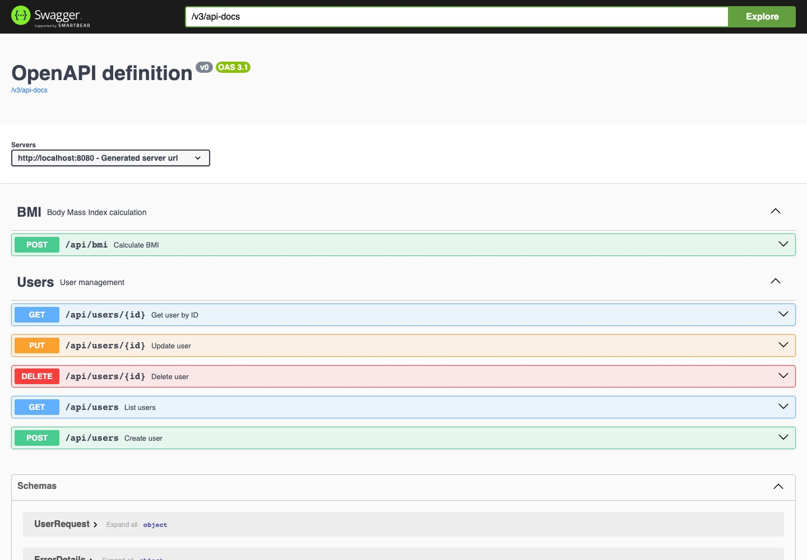
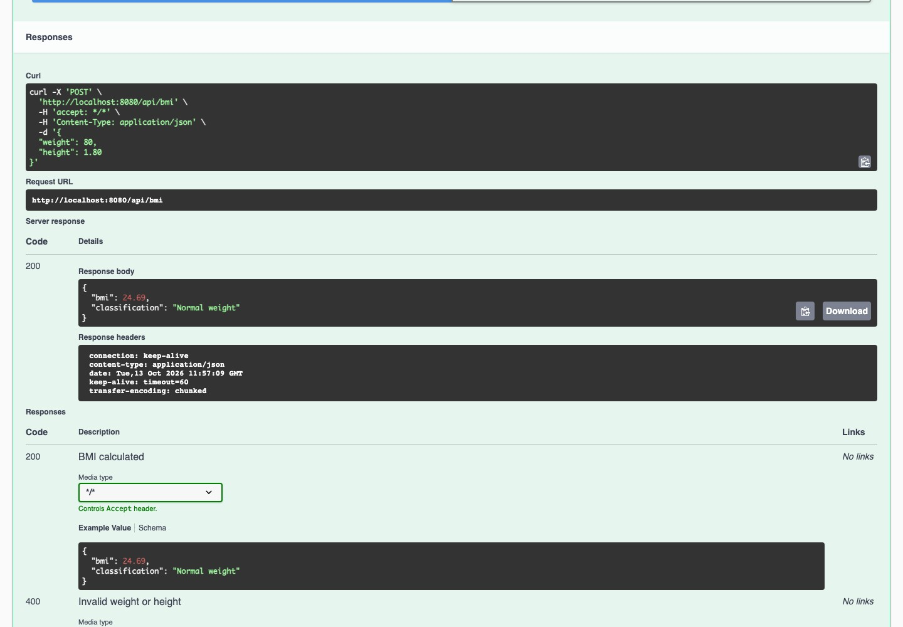
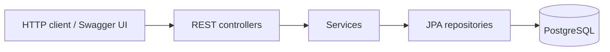

# BMI Service — User management and BMI API

A Spring Boot REST API for managing user records and calculating body mass index
from weight and height.

**Status:** Educational backend project.

[](https://github.com/ErickHTF/bmi-service/actions/workflows/ci.yml)
  

[Run locally](#run-locally) · [Development guide](docs/development.md) ·
[Architecture](docs/architecture.md) · [API reference](docs/api.md)



<details>
<summary>Execute a BMI calculation</summary>



</details>

_Screenshots show the running API through its bundled Swagger interface._

## Overview

BMI Service demonstrates a small Java backend with validation, persistence and
consistent HTTP responses.

- Create, list, update and delete user records.
- Calculate BMI from weight in kilograms and height in meters.
- Return a BMI classification alongside the calculated value.
- Validate request fields and return structured error responses.
- Explore and execute requests through Swagger UI.

## Stack

| Layer             | Technologies                                            |
| ----------------- | ------------------------------------------------------- |
| Backend           | Java 17, Spring Boot, Spring Web, Spring Data JPA       |
| Database          | PostgreSQL 13, Docker Compose                           |
| API documentation | Swagger UI, OpenAPI                                     |
| Verification      | JUnit, Spring MVC tests, Testcontainers, GitHub Actions |

## Run locally

Install **Java 17+**, **Git**, and **Docker with Docker Compose**. Maven is
included through the wrapper.

```bash
git clone https://github.com/ErickHTF/bmi-service.git
cd bmi-service
docker compose up -d
./mvnw spring-boot:run
```

Open [Swagger UI](http://localhost:8080/swagger-ui.html) to explore the API.
The database uses port `5433`; the application uses port `8080`.

Try a calculation:

```bash
curl -X POST http://localhost:8080/api/bmi \
  -H 'Content-Type: application/json' \
  -d '{"weight":80,"height":1.80}'
```

```json
{ "bmi": 24.69, "classification": "Normal weight" }
```

See the [development guide](docs/development.md) for database settings and user
creation examples.

## Verification

```bash
./mvnw verify
```

Unit and web-layer tests run without infrastructure. The application test uses a
PostgreSQL Testcontainer and is skipped when Docker is unavailable. Keep Docker
running to execute the full suite.

## Architecture



Validated request and response DTOs separate the API contract from persistence
entities. A global exception handler produces structured error responses. Read
the [architecture guide](docs/architecture.md) for package responsibilities.

## Documentation

| Guide                                | Contents                                   |
| ------------------------------------ | ------------------------------------------ |
| [Development](docs/development.md)   | Database setup, request examples and tests |
| [Architecture](docs/architecture.md) | Packages and layer responsibilities        |
| [API reference](docs/api.md)         | Endpoints, validation and error responses  |

## Project context

Built to practice backend development with the Spring ecosystem, PostgreSQL,
containerized local infrastructure and automated tests.

No license is currently included in this repository.
